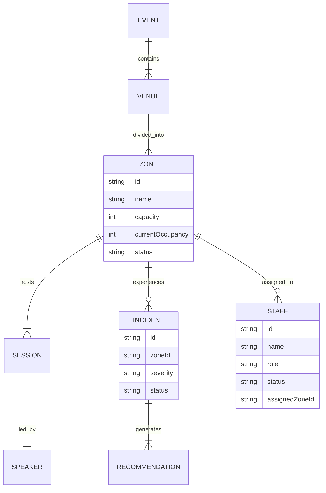

# VantageOS: Visual Mock Database Architecture
*A Premium AI-Powered Event Operations Command Center Database Layer*

## 1. High-Level Database Strategy

The VantageOS database is designed to feel indistinguishable from a production event-driven backend. It uses a **relational, normalized data model** suitable for a PostgreSQL/Supabase migration, while currently living entirely in a local Zustand store and JSON seed files.

**Key Architectural Pillars:**
- **Normalized Relational Data:** Entities reference each other via UUIDs (e.g., `zoneId`, `staffId`) rather than deeply nested objects, allowing scalable joins and updates.
- **Computed Real-Time State:** The "Pulse" of the event (live occupancy, alert severities) is computed dynamically from base state variables using Zustand selectors.
- **Strict Typing:** A single source of truth for TypeScript interfaces ensures the UI and store consume the exact same models that a future backend will provide.
- **Deterministic Action Payloads:** Store mutations receive precise, backend-like payloads (e.g., `resolveAlert({ alertId, resolutionNotes })`).

---

## 2. Entity List & Relationships

### Core Entities
* **Event:** The top-level container (e.g., "Global Tech Summit 2026").
* **Venue:** The physical building. Has many `Zones`.
* **Zone (Hall):** A specific area (Hall A, Main Stage). Tracks capacity and current occupancy.
* **Session:** A scheduled activity occurring within a `Zone`. Has one `Speaker`.
* **Speaker:** Presenter for a session.
* **Attendee:** Guests registered for the event.

### Operations Entities
* **Staff:** Personnel available for deployment. Tracks role, skills, and current status.
* **Resource:** Physical inventory (Stanchions, Scanners).
* **Vendor:** Third-party partners (Catering, AV).

### Incident & Intelligence Entities
* **Incident (Alert):** An active anomaly (e.g., "Hall B Overcrowding"). References a `Zone`.
* **Recommendation:** AI-generated mitigation payloads linked to an `Incident`.
* **LogLine:** Immutable audit trail of system and operator actions.

### Relationships (Foreign Keys)
- `Zone` -> `venueId`
- `Session` -> `zoneId`, `speakerId`
- `Incident` -> `zoneId`
- `Recommendation` -> `incidentId`
- `Staff` -> `assignedZoneId` (nullable)

---

## 3. Visual Database Map



---

## 4. Folder Structure

We use a modular, scalable architecture ready for enterprise.

```
src/
├── types/
│   └── database.ts            # Centralized schema interfaces
├── seed/
│   ├── index.ts               # Loader utility
│   ├── zones.json             # Seed data files...
│   ├── sessions.json
│   ├── staff.json
│   ├── incidents.json
│   └── recommendations.json
└── store/v2/
    ├── databaseStore.ts       # Main hook exposing all DB entities
    └── selectors/
        └── dashboard.ts       # Derived analytics (total counts, health)
```

---

## 5. Type Definitions (`src/types/database.ts`)

Included in the source code. See `src/types/database.ts` for full implementation.

---

## 6. Seed JSON Content (Extracts)

Included in the source code. See `src/seed/mockData.ts` for full implementation.

---

## 7. Zustand Store Implementation

Included in the source code. See `src/store/v2/databaseStore.ts` for full implementation.

---

## 8. Selectors / Derived State

Selectors live outside the main store object to prevent unnecessary re-renders in React.

```typescript
// src/store/v2/selectors/dashboard.ts
import { useDatabaseStore } from '../databaseStore';

export const useLiveMetrics = () => {
  return useDatabaseStore((state) => {
    const zones = Object.values(state.zones);
    const incidents = Object.values(state.incidents);

    const totalAttendees = zones.reduce((sum, z) => sum + z.currentOccupancy, 0);
    const activeCriticalAlerts = incidents.filter(i => i.status === 'ACTIVE' && i.severity === 'CRITICAL').length;
    
    // Overall Health Score: 100 - (10 * active criticals) - (2 * active warnings)
    const venueHealthScore = Math.max(0, 100 - (activeCriticalAlerts * 10));

    return { totalAttendees, activeCriticalAlerts, venueHealthScore };
  });
};
```

---

## 9. Demo Action Flows

To make the app feel alive for the judges, we trigger exact sequence chains using the unified store interface:

1. **`resetDemoScenario()`**: Clears all incidents, resets occupancy bounds.
2. **`triggerOvercrowding('ZONE-HALL-B')`**: Instantly maxes out Hall B capacity, drops Venue Health Score, pops an Active Incident card on the UI, and generates a corresponding `AiRecommendation`.
3. **`applyRecommendation('REC-001')`**: The magical "1-Click Auto Mitigate." It reads the action payload, updates Zone states, shifts 2 staff members automatically to Hall A, and resolves the Alert.
4. **`delaySession('SESS-104', 15)`**: Pushes back a session start time, updating all UI schedules globally.

---

## 10. UI Consumption Examples

**Dashboard Card Component:**
```tsx
import { useLiveMetrics } from '@/store/v2/selectors/dashboard';

export function VenueHealthCard() {
  const { venueHealthScore, activeCriticalAlerts } = useLiveMetrics();
  
  return (
    <div className={`radar-panel ${activeCriticalAlerts > 0 ? 'border-destructive critical-pulse' : 'border-primary'}`}>
      <h3>Venue Health</h3>
      <div className="score text-4xl font-mono">{venueHealthScore}%</div>
      {activeCriticalAlerts > 0 && <span className="warning-blip">Critical Anomalies Detected</span>}
    </div>
  );
}
```

**AI Recommendation Drawer (1-Click Fix):**
```tsx
import { useDatabaseStore } from '@/store/v2/databaseStore';

export function RecommendationPopup({ recId }) {
  const applyRecommendation = useDatabaseStore(s => s.applyRecommendation);
  const rec = useDatabaseStore(s => s.recommendations[recId]);

  return (
    <div className="bg-primary/10 border border-primary p-4">
      <p>AI Strategy: {rec.description}</p>
      <p>Confidence: {rec.confidenceScore * 100}%</p>
      <button onClick={() => applyRecommendation(rec.id)} className="btn-auto-mitigate glow">
        EXECUTE MITIGATION
      </button>
    </div>
  );
}
```

---

## 11. Migration Notes (Supabase Integration)

Because we structured this using discrete entities and normalized state (`Record<string, Entity>` is standard for simulating Redux/backend dictionaries), migrating to Supabase is trivial.

**Steps to Migrate:**
1. **Tables:** Create matching tables in Supabase: `Zones`, `Incidents`, `Recommendations`, `Staff`, `Sessions`.
2. **Types:** Replace `src/types/database.ts` with auto-generated Supabase types (`supabase gen types typescript`).
3. **Store Actions:** Replace synchronous Zustand mutations with async API calls:
    ```typescript
    // MOCK
    applyRecommendation: (id) => set(...)
    
    // SUPABASE
    applyRecommendation: async (id) => {
      await supabase.from('Recommendations').update({ status: 'ACCEPTED' }).eq('id', id);
      // Let Supabase Realtime trigger the state update downstream
    }
    ```
4. **Realtime Subscriptions:** Instead of `setInterval` ticks for simulation, use Supabase Realtime `on('postgres_changes')` to dispatch updates directly into the Zustand store. The frontend UI components will re-render identically since they observe the exact same state shape.
